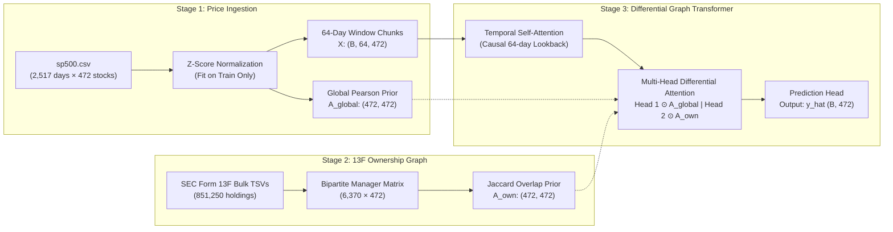

# Stock Market Forecasting with Differential Graph Transformer (DGT)

[](https://www.python.org/downloads/release/python-3120/)
[](https://github.com/astral-sh/uv)
[](https://pytorch.org/)
[](https://opensource.org/licenses/MIT)

A multi-relational graph deep learning framework for next-day stock price forecasting across the S&P 500 equity universe. This project combines temporal self-attention across historical trading windows with spatial **Differential Graph Attention (`MultiheadDiffAttn`)** conditioned simultaneously on macro price co-movement and institutional ownership networks.

For comprehensive architectural specifications, UML class diagrams, and tensor flowcharts, see [architecture.md](architecture.md).

---

## Table of Contents

- [Overview & Key Innovations](#overview--key-innovations)
- [System Architecture & Data Flow](#system-architecture--data-flow)
- [Prerequisites & Environment](#prerequisites--environment)
- [Installation Guide](#installation-guide)
- [Quickstart: Pipeline Execution](#quickstart-pipeline-execution)
- [Verification Metrics & Expected Tensor Dimensions](#verification-metrics--expected-tensor-dimensions)
- [Core Methodology & Mathematical Foundations](#core-methodology--mathematical-foundations)
- [Repository Structure](#repository-structure)
- [Data Management & Caching](#data-management--caching)
  - [External Ingestion & Caching Policy](#external-data-ingestion--caching-policy)
  - [SEC Form 13F Raw Data & Git Exclusion](#sec-form-13f-raw-data-files--git-tracking-exclusion)
  - [Inspecting Serialized Priors (.pt)](#inspecting-serialized-priors-pt-files)
- [Developer Guide: Extending the Project](#developer-guide-extending-the-project)
- [References](#references)

---

## Overview & Key Innovations

Predicting stock market dynamics requires capturing both temporal dependencies (momentum, trend reversals) and spatial relationships (sector co-movements, institutional capital flows). Standard Graph Neural Networks (GNNs) and transformers often suffer from feature oversmoothing and noise amplification when applied to dense financial correlation graphs.

This framework implements the **Differential Graph Transformer (DGT)** (adapted from Li & Pourbabaee, 2025; Ye et al., 2024), featuring:

1. **Dual-Prior Relational Topology:**
   - **Head 1: Macro Pearson Correlation Prior ($A^{\text{global}} \in \mathbb{R}^{472 \times 472}$):** Derived strictly from in-sample historical price correlations across 2,517 trading days.
   - **Head 2: Institutional Co-Holding Prior ($A^{\text{own}} \in \mathbb{R}^{472 \times 472}$):** Derived from quarterly SEC Form 13F institutional holdings across 6,370 active managers (excluding passive indexers), measuring institutional co-investment via Jaccard similarity.
   - **Heads 3 & 4: Data-Driven Latent Interactions:** Unconstrained differential attention heads that learn dynamic spatial affinities directly from data.

2. **Noise-Canceling Differential Graph Attention:**
   Subtracts two separate softmax attention maps to cancel high-frequency background market noise while amplifying task-relevant cross-stock signals modulated by prior topologies.

3. **Lightweight, Native PyTorch Design:**
   Replaces fragile, unmaintained legacy packages (`torch_geometric_temporal`, `torch-scatter`, `torch-sparse`) with standard, high-performance PyTorch `nn.Module` and `DataLoader` abstractions. Fully compatible with macOS (Apple Silicon MPS), Linux, and CUDA.

---

## System Architecture & Data Flow

The pipeline executes in three synchronized stages:



---

## Prerequisites & Environment

| Requirement | Supported Version | Notes |
| :--- | :--- | :--- |
| **Operating System** | macOS (Apple Silicon / Intel), Linux, Windows (WSL2) | Tested on macOS 14+ and Ubuntu 22.04+ |
| **Python** | `3.12.x` (`>=3.12, <3.13`) | Pinned in [.python-version](.python-version) and [pyproject.toml](pyproject.toml). Python 3.13+ is not yet supported by PyTorch 2.2.2 wheels. |
| **Package Manager** | [`uv`](https://docs.astral.sh/uv/) (recommended) | Astral's ultra-fast package manager. Standard `pip` and `venv` are also supported. |
| **Compute Hardware** | CPU, Apple Silicon (MPS), NVIDIA GPU (CUDA) | Automatically supported through PyTorch device placement. |

---

## Installation Guide

### Option 1: Fast Installation via `uv` (Recommended)

1. **Install `uv`** (if not already installed):
   ```bash
   # macOS / Linux
   curl -LsSf https://astral.sh/uv/install.sh | sh

   # macOS via Homebrew
   brew install uv
   ```

2. **Clone the repository:**
   ```bash
   git clone https://github.com/<your-username>/cs224w.git
   cd cs224w
   ```

3. **Synchronize dependencies and create virtual environment:**
   ```bash
   uv sync
   ```
   This automatically creates a `.venv` folder with the exact locked dependency versions from `uv.lock`.

4. **Verify the installation:**
   ```bash
   uv run python main.py
   ```
   *Expected output:* `Hello from cs224w!`

---

### Option 2: Standard Installation via `pip` and `venv`

If you prefer using standard Python tools:

```bash
# 1. Create a Python 3.12 virtual environment
python3.12 -m venv .venv
source .venv/bin/activate

# 2. Install dependencies in editable mode
pip install --upgrade pip
pip install -e .
```

---

## Quickstart: Pipeline Execution

The system is designed to run in three sequential, reproducible steps:

### Step 1: Price Ingestion, Temporal Chunking & Correlation Prior

Run [src/data/price_loader.py](src/data/price_loader.py):

```bash
uv run python src/data/price_loader.py
```

- **Actions performed:**
  1. Checks for local `data/sp500.csv` (downloads automatically from GitHub if absent).
  2. Ingests 2,517 trading days across 472 constituents (2014-10-31 to 2024-10-31).
  3. Partitions data chronologically into 80% Train (1,949 days), 10% Validation (188 days), and 10% Test (188 days) with zero forward leakage.
  4. Fits per-stock Z-score normalization strictly on the training partition.
  5. Slices continuous price series into 64-day lookback rolling windows ($X_t \in \mathbb{R}^{B \times 64 \times 472}$) with next-day target prices ($y_t \in \mathbb{R}^{B \times 472}$).
  6. Computes the symmetric Pearson correlation matrix $A^{\text{global}} \in \mathbb{R}^{472 \times 472}$.

---

### Step 2: SEC Form 13F Parsing & Institutional Ownership Graph

Run [src/data/parse_13f_pilot.py](src/data/parse_13f_pilot.py):

```bash
uv run python src/data/parse_13f_pilot.py
```

- **Actions performed:**
  1. Discovers and downloads the SEC EDGAR Form 13F Q1 2024 bulk data archive (`01mar2024-31may2024_form13f.zip`) and company ticker directory.
  2. Parses `SUBMISSION.tsv`, `COVERPAGE.tsv`, and `INFOTABLE.tsv`, filtering records down to the 472 S&P 500 constituent tickers.
  3. Filters passive index noise: excludes mega passive indexers (Vanguard, BlackRock, SSGA, Geode, Northern Trust) and micro-positions ($< \$1\text{M}$ market value) to isolate active institutional management.
  4. Constructs the bipartite manager-stock ownership matrix across 6,370 active managers and 851,250 equity records.
  5. Computes the Jaccard similarity matrix $A^{\text{own}} \in \mathbb{R}^{472 \times 472}$ with diagonal self-loops ($A_{ii} = 1.0$).
  6. Serializes the resulting tensor to `data/A_own_pilot.pt`.

---

### Step 3: DGT Baseline Model Forward Pass & Gradient Verification

Run [src/models/forward_test.py](src/models/forward_test.py):

```bash
uv run python src/models/forward_test.py
```

- **Reproducibility & Seeding:** `forward_test.py` is **seeded by default (`seed=42`)** for deterministic verification against the metrics below. To avoid seed hacking during training or to stress-test the smoke check across arbitrary initializations, disable seeding or pass custom seeds:
  ```bash
  uv run python src/models/forward_test.py --unseeded    # Non-deterministic smoke test
  uv run python src/models/forward_test.py --seed 123    # Custom seed for multi-seed evaluation
  ```

- **Actions performed:**
  1. Loads a live mini-batch of prices ($X \in \mathbb{R}^{32 \times 64 \times 472}$, $y \in \mathbb{R}^{32 \times 472}$) from `price_loader.py`.
  2. Ingests both topological priors: $A^{\text{global}}$ (correlation) and $A^{\text{own}}$ (ownership).
  3. Instantiates `DifferentialGraphTransformer` with 4-head differential spatial attention.
  4. Executes the forward pass to produce next-day forecasts $\hat{y} \in \mathbb{R}^{32 \times 472}$.
  5. Computes batch Mean Squared Error (MSE) loss and performs a backward pass to verify non-zero gradient propagation.

---

## Verification Metrics & Expected Tensor Dimensions

When running the pipeline verification (`src/models/forward_test.py`), confirm your environment matches the expected tensor dimensions and metrics below:

### End-to-End Tensor Verification Table

| Tensor Entity | Code Variable | Dimensions / Shape | Description |
| :--- | :--- | :--- | :--- |
| **Input Feature Chunk** | `sample_x` | `(32, 64, 472)` | `Batch=32`, `Lookback T=64`, `Stocks N=472` |
| **Ground Truth Target** | `sample_y` | `(32, 472)` | `Batch=32`, `Target Price Vector N=472` |
| **Price Correlation Prior** | `A_global` | `(472, 472)` | Symmetric Pearson correlation, range $[-0.942, 1.000]$ |
| **Institutional 13F Prior** | `A_own` | `(472, 472)` | Jaccard co-holding overlap, non-zero density $88.04\%$ |
| **Temporal Transformer State** | `h_final` | `(32, 472, 64)` | Final hidden state across lookback ($d=64$) |
| **Differential Spatial Map** | `diff_attn` | `(32, 4, 472, 472)` | `(Batch, Heads=4, N=472, N=472)` |
| **Model Forecast Output** | `y_hat` | `(32, 472)` | Predicted standardized price vector |
| **Verification Loss & Gradients** | `loss` | `1.1222` | Initial sanity MSE loss (`seed=42`); valid gradients on all parameters |

### Sample Institutional Overlap Sub-Matrix ($A^{\text{own}}$)

The pilot parsing of SEC Form 13F Q1 2024 institutional co-holdings yields the following Jaccard similarity sub-matrix across mega-cap equities:

| Ticker | AAPL | MSFT | NVDA | AMZN | META |
| :--- | :---: | :---: | :---: | :---: | :---: |
| **AAPL** | **1.000** | 0.792 | 0.700 | 0.754 | 0.633 |
| **MSFT** | 0.792 | **1.000** | 0.746 | 0.811 | 0.675 |
| **NVDA** | 0.700 | 0.746 | **1.000** | 0.764 | 0.709 |
| **AMZN** | 0.754 | 0.811 | 0.764 | **1.000** | 0.709 |
| **META** | 0.633 | 0.675 | 0.709 | 0.709 | **1.000** |

---

## Core Methodology & Mathematical Foundations

### 1. Temporal Lookback Framing ($T = 64$)

Standard financial time series must be structured into causal input-target pairs. Slicing with a window size of $T=64$ trading days constructs supervised training samples:

$$X_t = [P_{t-63}, P_{t-62}, \dots, P_t] \in \mathbb{R}^{64 \times N}, \quad y_t = P_{t+1} \in \mathbb{R}^{N}$$

A window of 64 trading days corresponds to approximately one full financial quarter (~63–64 trading days). This allows the internal temporal transformer to capture quarterly trend persistence, momentum, and mean-reversion signals rather than relying solely on high-noise 1-day lags. The temporal encoder explicitly enforces causality across this lookback window using an upper-triangular attention mask (`nn.Transformer.generate_square_subsequent_mask(T)`), ensuring that any day $\tau \in [1, 64]$ attends strictly to historical trading days $\tau' \le \tau$ with zero forward sequence leakage.

### 2. Multi-Head Differential Spatial Graph Attention

Standard softmax attention computes affinity matrices that often assign non-negligible weights to irrelevant tokens or equities. Following the Differential Transformer formulation (Ye et al., 2024) and DGT (Li & Pourbabaee, 2025), differential attention subtracts two separate softmax attention maps to cancel noise, modulated element-wise by the relational graph prior matrix $A$:

$$\text{DiffAttn}(X, A) = \left( \text{softmax}\!\left(\frac{Q_1 K_1^\top}{\sqrt{d}}\right) \odot A \;-\; \lambda \cdot \text{softmax}\!\left(\frac{Q_2 K_2^\top}{\sqrt{d}}\right) \right) V$$

where $\lambda$ is a learnable scalar re-parameterized to guarantee stability:

$$\lambda = \exp(\lambda_{q1} \cdot \lambda_{k1}) - \exp(\lambda_{q2} \cdot \lambda_{k2}) + \lambda_{\text{init}}$$

- **Head 1:** Ingests $A^{\text{global}}$, modulating spatial attention by long-term macro co-movements.
- **Head 2:** Ingests $A^{\text{own}}$, modulating spatial attention by common institutional ownership and capital allocation.
- **Heads 3 & 4:** Operate without static prior masks ($A = \mathbf{1}_{N \times N}$), enabling the model to learn dynamic, latent cross-stock interactions.

*(Note on Indexing: Heads are 1-indexed in mathematical documentation [Heads 1–4] and 0-indexed in PyTorch code [Heads 0–3], configured via `adj_priors=[A_global, A_own]` or `{0: A_global, 1: A_own}`).*

### 3. Resolution of PyG-Temporal Compatibility Issues

The reference Colab benchmark utilized `torch_geometric_temporal`. This library depends on unmaintained C++ bindings (`torch-scatter`, `torch-sparse`, `torch-cluster`) that frequently fail to compile on modern Python 3.12 environments and modern PyTorch 2.x wheels.

Furthermore, `torch_geometric_temporal` forces models into rigid signal wrappers (`DynamicGraphTemporalSignal`). In our implementation ([src/models/dgt.py](src/models/dgt.py)), the architecture is written directly as modular PyTorch `nn.Module` classes using standard tensor layouts `(Batch, Lookback, Nodes, Features)`. This eliminates external compilation dependencies and ensures full cross-platform reproducibility.

---

## Repository Structure

```text
cs224w/
├── README.md                # Project documentation and onboarding guide
├── architecture.md          # Comprehensive UML class diagrams and pipeline specs
├── pyproject.toml           # Package configuration and dependencies (hatchling)
├── uv.lock                  # Deterministic dependency lockfile
├── .python-version          # Pinned Python version (3.12)
├── main.py                  # Minimal entrypoint script
├── data/                    # Data directory (cached inputs and generated priors)
│   ├── sp500.csv            # 10-year daily price records (2,517 days × 472 stocks)
│   ├── A_own_pilot.pt       # Serialized institutional ownership prior (472 × 472, ~890 KB)
│   ├── company_tickers.json # SEC CIK ↔ Ticker ↔ Title metadata cache (~2.8 MB)
│   └── sec_13f_2024q1/      # [Git-ignored ~300 MB] Raw SEC Form 13F TSVs (auto-fetched via Step 2)
└── src/
    ├── data/
    │   ├── price_loader.py      # Stage 1: Price download, chunking, A_global prior
    │   └── parse_13f_pilot.py   # Stage 2: SEC EDGAR 13F parsing & A_own prior
    └── models/
        ├── dgt.py               # MultiheadDiffAttn & DifferentialGraphTransformer
        └── forward_test.py      # Stage 3: End-to-end forward/backward verification
```

---

## Data Management & Caching

### External Data Ingestion & Caching Policy

1. **S&P 500 Daily Prices:**
   - **Source:** Standard historical S&P 500 feed (`AlienKevin/sp500`).
   - **Caching:** Downloaded on first execution to `data/sp500.csv`. If present, subsequent runs load directly from disk.

2. **SEC Form 13F Bulk Datasets:**
   - **Source:** Official SEC EDGAR Structured Data Sets (`sec.gov/data-research/sec-markets-data/form-13f-data-sets`).
   - **Caching:** Downloaded zip archives are extracted to `data/sec_13f_2024q1/`.
   - **SEC User-Agent Policy:** The SEC requires an explicit descriptive `User-Agent` string (e.g. `StanfordUniversity StudentResearch cs224w-project@stanford.edu`). Requests with default headers (e.g. `python-requests` or `curl`) are rejected with HTTP 403 Forbidden. This is already handled in `src/data/parse_13f_pilot.py`.

3. **Offline / Air-Gapped Operation:**
   If working without internet access, simply place pre-downloaded files into the `data/` directory:
   - `data/sp500.csv`
   - `data/company_tickers.json`
   - `data/sec_13f_2024q1/INFOTABLE.tsv` and `data/sec_13f_2024q1/SUBMISSION.tsv`

### SEC Form 13F Raw Data Files & Git Tracking Exclusion

The raw unpacked directory `data/sec_13f_2024q1/` is **explicitly excluded from Git tracking** in [.gitignore](.gitignore) due to file size constraints:

- **Why It Is Not in Git:**
  - GitHub enforces a strict **100 MB per-file limit** and recommends keeping repositories under 1–5 GB.
  - The uncompressed SEC 13F bulk dataset contains `INFOTABLE.tsv`, which is **~295 MB**, bringing the total folder size to **~301 MB**. Pushing this file directly would cause git pushes to fail.

- **Significance & Schema of the Bulk TSV Files:**
  The SEC EDGAR Q1 2024 bulk dataset contains multiple tab-delimited relational tables. The two primary files consumed by [src/data/parse_13f_pilot.py](src/data/parse_13f_pilot.py) are:
  - **`INFOTABLE.tsv` (~295 MB):** The security-level holdings master table. Reports every equity holding for institutional investment managers managing $\ge \$100\text{M}$ in Section 13(f) securities. Key columns include:
    - `ACCESSION_NUMBER`: Unique 20-character identifier for each quarterly filing.
    - `NAMEOFISSUER`: Corporate name of the issuing company (e.g., `APPLE INC`, `MICROSOFT CORP`).
    - `CUSIP`: 9-character Committee on Uniform Securities Identification Procedures identifier.
    - `VALUE`: Fair market value of the holding (expressed in thousands of USD).
    - `SSHPRNAMT`: Number of shares or principal amount held.
  - **`SUBMISSION.tsv` (~609 KB):** The filer-level metadata table. Connects each `ACCESSION_NUMBER` to institutional manager identities:
    - `CIK`: Central Index Key identifying the institutional entity.
    - `FILING_MANAGER_NAME`: Legal business name of the investment manager (e.g., *Vanguard Group Inc*, *BlackRock Inc*, *Berkshire Hathaway Inc*).
    - `PERIOD_OF_REPORT` / `FILING_DATE`: Timestamp of the reported position quarter.
  - **Supporting Files (`COVERPAGE.tsv`, `SIGNATURE.tsv`, `SUMMARYPAGE.tsv`, `OTHERMANAGER.tsv`):** Additional SEC audit tables containing signatory validation, co-filer cross-references, and summary holding counts.

- **Distillation into Lightweight Tensor (`A_own_pilot.pt`):**
  - New developers **do not need** to commit or manually handle the 295 MB `INFOTABLE.tsv`.
  - When `uv run python src/data/parse_13f_pilot.py` runs, it filters 851,250 equity records down to the 472 S&P 500 constituents and computes the Jaccard similarity matrix $A^{\text{own}} \in \mathbb{R}^{472 \times 472}$.
  - The distilled tensor is serialized to `data/A_own_pilot.pt` (**~890 KB**), which **is** tracked in Git and can be immediately loaded by the model without requiring the raw 300 MB bulk directory.

### Inspecting Serialized Priors (`.pt` Files)

The institutional ownership matrix is saved in native PyTorch format at `data/A_own_pilot.pt`. You can inspect or export it in Python:

```python
import torch
import numpy as np
import pandas as pd

# Load saved tensor
A_own = torch.load("data/A_own_pilot.pt")
print(f"Shape: {A_own.shape}")
print(f"Density: {(A_own > 0).float().mean():.2%}")
print(f"Min: {A_own.min():.4f}, Max: {A_own.max():.4f}")

# Optional: Export sub-matrix to NumPy or CSV
np.save("data/A_own.npy", A_own.numpy())
```

---

## Developer Guide: Extending the Project

### Adding a New Graph Prior

To introduce a new domain graph (e.g., GICS Sector/Industry co-membership, supply chain relations, or patent citation links):

1. Construct a symmetric matrix $A^{\text{new}} \in \mathbb{R}^{472 \times 472}$ indexed identically to the 472 tickers from `price_loader.py`.
2. Save the tensor as `data/A_new.pt`.
3. In [src/models/dgt.py](src/models/dgt.py), pass $A^{\text{new}}$ into one of the unconstrained attention heads (Head 3 or Head 4) inside `DifferentialGraphTransformer.forward()`.

### Adjusting Model Hyperparameters

The model accepts standard architectural configurations upon instantiation:

```python
from src.models.dgt import DifferentialGraphTransformer

model = DifferentialGraphTransformer(
    num_stocks=472,      # Number of constituents
    window_size=64,      # Temporal lookback window (T)
    embed_dim=64,        # Latent projection dimension (must be divisible by num_heads)
    num_heads=4,         # Number of differential attention heads
    dropout=0.1,         # Dropout rate
    lambda_init=0.8,     # Initial differential cancellation factor
)
```

### Managing Dependencies

Always use `uv` to add or update packages to maintain cross-platform synchronization in `uv.lock`:

```bash
# Add a runtime dependency
uv add scikit-learn

# Add a development / testing dependency
uv add --dev pytest black ruff
```

---

## References

1. **Differential Graph Transformer (DGT):**
   Li, X., & Pourbabaee, F. (2025). *Stock Market Forecasting with Differential Graph Transformer*. Stanford CS224W Medium Publication. [Read on Medium](https://medium.com/stanford-cs224w/stock-market-forecasting-with-differential-graph-transformer-62d095ebc821).
2. **Differential Transformer:**
   Ye, T., Dong, L., Gao, Y., Song, Y., & Wei, F. (2024). *Differential Transformer*. arXiv preprint [arXiv:2410.05258](https://arxiv.org/abs/2410.05258).
3. **SEC EDGAR Form 13F Bulk Data Sets:**
   U.S. Securities and Exchange Commission, Division of Economic and Risk Analysis (DERA) (2024). *Form 13F – Institutional Investment Manager Filings*. [SEC Form 13F Data Sets](https://www.sec.gov/data-research/sec-markets-data/form-13f-data-sets).
4. **S&P 500 Normalization & Financial Time-Series Setup:**
   Shi, J., & Hollifield, B. (2024). *Predictive Power of LLMs in Financial Markets*. arXiv preprint [arXiv:2411.16569](https://arxiv.org/abs/2411.16569).
5. **Stanford CS224W: Machine Learning with Graphs:**
   Leskovec, J. (2026). [CS224W Course Homepage](https://web.stanford.edu/class/cs224w/).
