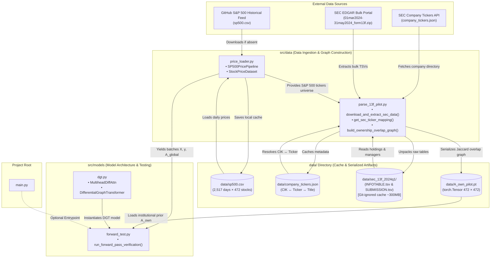
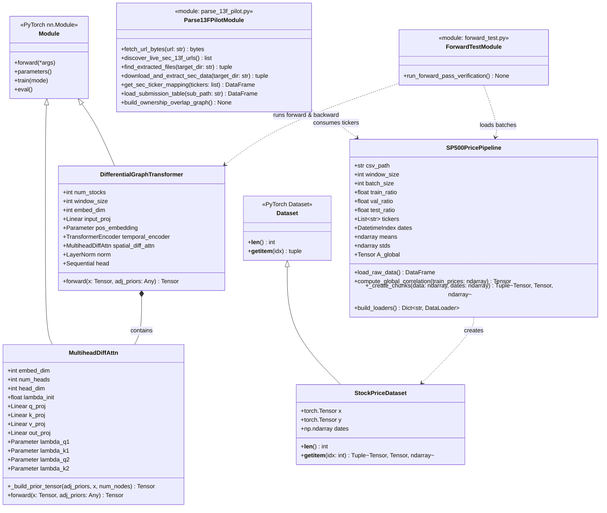
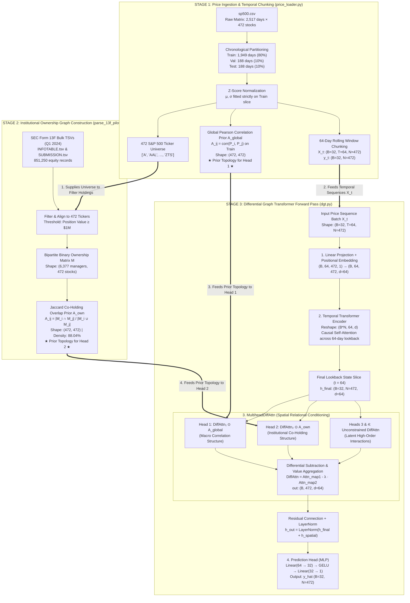
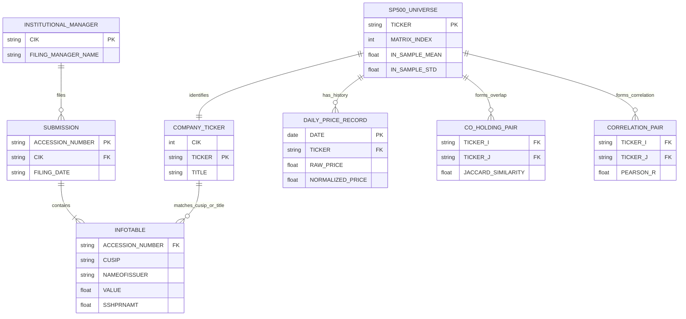

# CS224W Project Architecture & Dependency Map

This document outlines the software architecture, module dependencies, data pipelines, class models, and tensor transformations across `src/data` and `src/models` for the **Stock Market Forecasting with Differential Graph Transformer (DGT)** system.

---

## 1. High-Level System Dependency Map

The diagram below maps all project modules, external ingestion endpoints, filesystem artifacts, and dependency flows across the pipeline:

---

## 2. UML Class Diagram (Code Entities & Interfaces)

This UML diagram captures the object-oriented structure, class inheritance, methods, attributes, and relations in `src/data` and `src/models`:

---

## 3. End-to-End Tensor Dimensionality & Data Flow

This chart traces tensor transformations chronologically through the three pipeline stages:

1. **Stage 1 (Price Pipeline)** establishes the 472-stock universe, extracts temporal chunks ($X_t$), and computes the **Global Correlation Prior ($A^{\text{global}}$)** for **Attention Head 1**.
2. **Stage 2 (SEC 13F Pipeline)** consumes the 472-stock universe from Stage 1, parses 851,250 institutional equity holdings, and constructs the **Jaccard Co-Holding Prior ($A^{\text{own}}$)** for **Attention Head 2**.
3. **Stage 3 (DGT Model Execution)** conditions multi-head differential spatial attention simultaneously on both graph topologies ($A^{\text{global}}$ and $A^{\text{own}}$) to forecast next-day cross-sectional prices ($\hat{y}_t$).

---

## 4. Entity-Relationship Data Model (SEC 13F & Price Series)

The entity relationships connecting institutional filers, filings, equity holdings, and the S&P 500 universe:

---

## 5. Module Execution & Verification Flow

| Step       | Script                                                                        | Input Files / Sources                                     | Core Function / Class                                  | Output Produced                                   | Verified Dimensions                                                       |
| :--------- | :---------------------------------------------------------------------------- | :-------------------------------------------------------- | :----------------------------------------------------- | :------------------------------------------------ | :------------------------------------------------------------------------ |
| **Step 1** | [price_loader.py](src/data/price_loader.py)                                   | `data/sp500.csv`                                          | `SP500PricePipeline`                                   | Train/Val/Test DataLoaders + $A^{\text{global}}$  | $X: [32, 64, 472]$ $y: [32, 472]$ $A^{\text{global}}: [472, 472]$ |
| **Step 2** | [parse_13f_pilot.py](src/data/parse_13f_pilot.py)                             | SEC EDGAR Q1 bulk TSVs, `company_tickers.json`            | `build_ownership_overlap_graph()`                      | `data/A_own_pilot.pt` (Jaccard similarity matrix) | $A^{\text{own}}: [472, 472]$ Density: $88.04\%$                       |
| **Step 3** | [dgt.py](src/models/dgt.py) [forward_test.py](src/models/forward_test.py) | Step 1 DataLoaders, $A^{\text{global}}$, $A^{\text{own}}$ | `DifferentialGraphTransformer` `MultiheadDiffAttn` | End-to-end forward/backward gradient check        | Forward $\hat{y}: [32, 472]$ Backward MSE loss: $0.8933$              |
